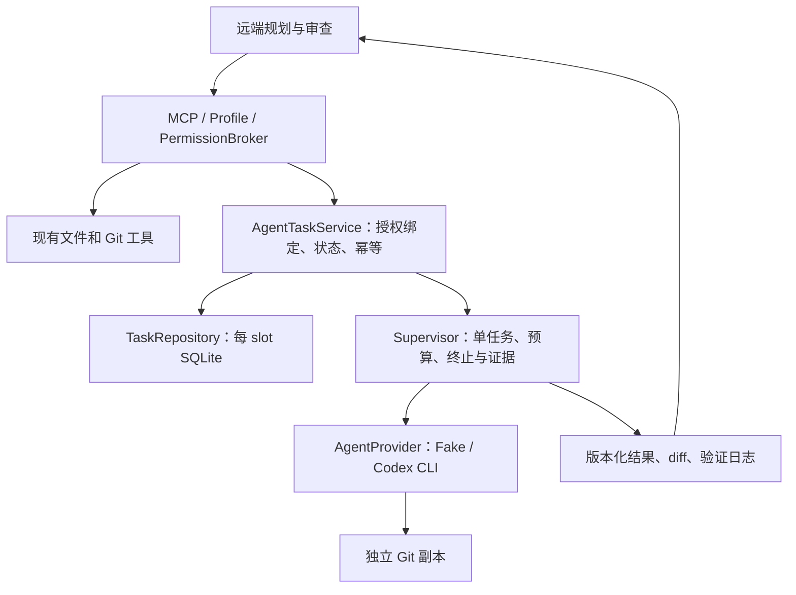

# P05 V2：MCP 文件契约与本地 Agent 委派试点

日期：2026-10-26
状态：实施候选方案；仅规划，功能尚未发布。
代码基线：`9defb33fd24774e4cfd28389b9bb7918f77ca945`（V2）。
唯一实施目录：`D:\Project_Git\P05_V2_Deployment`。默认会话目录中的旧项目不作为实施对象。

## 1. 目标与交付顺序

让远端在可靠识别文件版本的前提下，高效读取、修改和验证本地工程。保留直接 MCP 操作，同时增加一个可选路径：远端提出有边界的任务，由本地 Codex 执行，P05 提供可恢复的任务状态和可审查的证据。

分两个可独立验收的阶段：

| 阶段 | 用户可见结果 | 验收后才能推进的内容 |
| --- | --- | --- |
| A：文件契约 | 分段批量读取返回 SHA-256；同文件多处补丁一次预检；搜索说明覆盖范围；失败明确能否重试 | 独立发布，不依赖 Codex |
| B：委派试点 | 提交一个任务获得 runId；断线后查询状态、候选变更和验证记录；审查绑定证据版本 | 先 fake provider，再一次性样例仓库，再决定业务工程开放 |

阶段 B 首版只支持已注册的 Git 工作区、干净的已提交基线、每 Runtime slot 一个在途任务。执行目标是独立 Git 副本，任务结果通过 MCP 审查。接纳变更、合并、推送仍是后续显式动作。暂不做浏览器自动对话、多 Agent 调度、自动审查循环、跨机器调度或完整 V3 内核迁移。

## 2. 当前项目事实

- 已有 `fs_read_many`、`fs_write_many`、`apply_patch_many`、`fs_search`、`git_workspace_audit`、`project_validate`。
- `fs_read_many` 的 legacy 整文件路径输入保持兼容；A1 已加入显式 V2 范围读取，返回原始字节 SHA-256、totalLines、nextOffset、pendingIndexes 和有界 MCP 结果预算。A2 已加入同原文多编辑、dry_run、共享写锁和诚实的回滚效果报告。A3 已加入搜索 coverage、统一 outcome、MCP isError 与审计失败分类。A4 已加入四场景协议基准；不做模型效率结论。
- `apply_patch_many` 当前每文件一处唯一文本替换；有预检和普通错误回滚，但不提供跨文件崩溃原子性。
- `project_validate` 当前验证 P05 平台目录，不等同于验证任意当前业务工作区。
- `ExecutionRuntime` / `AuditStore` 记录一次工具调用，不能代替异步任务的持久化生命周期。
- V2 已有 PermissionBroker、workspace/reference 边界、profile、审计和 HTTP reviewer；新增能力必须接入这些入口。
- 仓库已有 V3 Run / ExecutionContext / Agent Provider / SQLite 设计，但此 V2 基线没有 `src/v3` 实现。通过边界接口复用概念，不整分支搬入历史实现。
- 本机实测：内置 Node `v22.23.1` 能打开 `node:sqlite` 内存数据库（SQLite `3.51.3`，Node 仍标记 experimental）；Codex CLI `0.147.0` 的本地帮助含 `exec --json`、`--sandbox`、`--ignore-user-config`。这些只是可用性证据，不是完成隔离、持久化或执行验收的证据。

## 3. 外部参考与取舍

| 参考 | 吸收的机制 | 在 P05 中的落点 |
| --- | --- | --- |
| dsh-ops | 范围读取、内容版本、原始版本上的多编辑、明确的完成/冲突/未知结果 | 阶段 A 的契约和故障测试 |
| codex-with-chatgpt | 远端规划/审查、本地执行，控制消息与文件证据分离，断线后不盲目重复执行 | 阶段 B 的任务 API、状态机与证据接口 |
| P05 V3 现有设计 | 执行上下文不可变、Provider 可替换、Run 状态持久化 | `AgentProvider` / `TaskRepository` 接口与迁移约束 |

参考固定到本次查阅版本：
- [dsh-ops 文件批处理](https://github.com/T-Auto/dsh-ops/blob/dfafddc941695090df2c6e2e323193785aec4eb6/docs/file-batching.md)
- [dsh-ops 结果契约](https://github.com/T-Auto/dsh-ops/blob/dfafddc941695090df2c6e2e323193785aec4eb6/docs/ptc-outcomes.md)
- [codex-with-chatgpt 中文说明](https://github.com/XiaoDuoYa/codex-with-chatgpt/blob/535a07dbb7aee887924c53767d985c09d405319d/README.zh-CN.md)
- [codex-with-chatgpt 协议](https://github.com/XiaoDuoYa/codex-with-chatgpt/blob/535a07dbb7aee887924c53767d985c09d405319d/docs/protocol.md)
- [P05 V3 技术方案](P05_V3_TECHNICAL_SOLUTION.md)
- [P05 Agent/Skill/Asset 契约](AGENT-SKILL-ASSET-CONTRACTS.md)

不引入 DSH 宿主特有的工具动态发布协议，也不把浏览器驱动的 C2C 循环当作可靠调度服务。参考源码如需复制，先单独检查其许可；本方案采用机制设计，无外部源码拷贝。

## 4. 结构与责任



Provider 只负责启动、事件转换和停止协议。任务状态、授权、审计、证据存储由 P05 持有，不随插件卸载消失。首版 Provider 放在独立模块，通过注册表选择；暂不强行扩大当前插件 API 的权限上下文。

## 5. 全局约束（R01—R12）

- **R01**：仅在上述 V2 基线上实施；沿用 TypeScript / Zod / MCP；旧工具名和旧请求的成功响应保持兼容。新语义显式使用 `contract_version: 2`。
- **R02**：路径、workspace、profile、审批和审计沿用现有控制点。工具调用固定 workspace binding；不使用客户端名称作为身份，不接受远端绝对宿主路径。
- **R03**：默认正文预算 64 KiB，硬上限 256 KiB（新契约序列化后的整个 MCP 结果 UTF-8 字节，含重复正文和信封）。超过预算必须可判断未返回范围，不能假装完整。
- **R04**：文件版本使用原始字节 SHA-256。补丁先验证所有目标和编辑，再写入；外部并发、进程崩溃和回滚失败必须报告真实效果，不能声称跨文件事务或通用文件系统 CAS。
- **R05**：阶段 B 默认禁用；本地单独启用并配置 Provider、验证器及预算。trusted approval 开关不会自动启用委派。首版每 slot 最大在途任务数为 1。
- **R06**：提交幂等、先持久化后启动；`UNKNOWN` 不自动重新执行。正常重试使用相同幂等键查询原任务；改动任务使用新键并可关联 parentRunId。
- **R07**：任务绑定不可变授权上下文和基线；审批只授权该次调度，不授权后续重试、合并或推送。HTTP reviewer 的新增任务工具仅查询，即使它配置为 developer/full 也不开放提交或取消。
- **R08**：执行使用独立 Git 副本及本地固定启动器，`shell:false`、`windowsHide:true`；prompt 经 stdin；远端不能提供启动命令、额外目录、环境变量或任意验证命令。
- **R09**：工作副本仅是写入和 Git 元数据隔离。Codex sandbox 不等同于 P05 工具逐项许可或整机读取隔离。真实 Provider 仅在本地明确选择的可信主机试点模式及进程管理验收通过后启用；无能力时失败关闭，不降低 sandbox。
- **R10**：证据由 P05 采集并绑定候选内容摘要和验证器配置摘要；自述测试结果单独标识。审查状态独立于执行状态，过期证据不能被接受。
- **R11**：任务存储每 slot 独立、单调事件序号、单调 workspace binding revision。resultRef 必须校验权限域和 workspace；raw log 不能通过普通 MCP 暴露，分页输出先脱敏并限额。
- **R12**：先 fake provider 故障测试，再一次性样例仓库真实试点。禁止以业务工程、真实凭据或自动 Git 集成为首次验收样本。

## 6. 阶段 A 的具体契约

### A1. 带版本的范围读取

`fs_read_many` 的旧 `{paths:[...]}` 分支保持不变；V2 分支使用：
```json
{
  "contract_version": 2,
  "requests": [{"path":"src/index.ts","offset":0,"limit":120}],
  "max_bytes": 65536
}
```
`paths` 与 `requests` 不能同时出现。offset 为从 0 开始的行偏移，limit 为行数（1—2000），每次 1—20 个请求；路径最多 1024 字符，max_bytes 最小 4096；结果行号从 1 开始。返回每文件 sha256、totalLines、实际范围、text、complete、nextOffset，以及批次 pendingIndexes。后续范围可附 `expected_sha256`，变化则冲突，不拼接不一致版本。

按原始字节计算 hash；UTF-8 严格解码，拒绝二进制和无效编码。CRLF 原样保留，空文件行数为 0，末尾换行不产生额外空行，UTF-8 BOM 只从展示移除，hash 仍包含 BOM。文件读取和元数据来自同一份受限缓冲区，单文件检查上限 8 MiB。无法容纳单行时返回 line-too-large 和文件版本，提示缩小查询/使用专门的大文件工具，不返回无进展游标。

默认 content.text 包含可读正文和范围说明，structuredContent 包含机器字段；预算统计两者，避免仅结构化输出导致某些客户端看不到文件。暂不引入自动内容去重或依赖客户端缓存的引用。

### A2. 同文件多处补丁

扩展 `apply_patch_many` V2 分支：
```json
{
  "contract_version": 2,
  "dry_run": true,
  "patches": [{
    "path":"src/example.ts",
    "expected_sha256":"a61f203d577d8c1d14a8d6fc203a327d8c15d784b54fed354d97b9a758108d12",
    "edits":[
      {"old_text":"const count = 1;","new_text":"const count = 2;"},
      {"old_text":"return count;","new_text":"return count + 1;"}
    ]
  }]
}
```
每文件 1—100 edits，最多 20 文件；old_text 非空且在原文中唯一出现；所有 edits 对同一原文求位置，拒绝重叠，按位置从后向前应用。重复目标路径包括大小写别名必须拒绝。dry_run 返回预期新 hash 和有界差异摘要，不写入。

新契约总候选正文上限 1 MiB；仍执行写目标策略和批量预检。P05 自身同路径写入共用互斥锁；发布前再次核对版本。外部进程仍可能竞争，因此不承诺 OS 级比较交换。回滚前确认文件仍是本次写出的 hash，发现外部改动则保留现场并报告 `unknown`。复用批量写入底层，不能新增另一套旁路路径策略。

### A3. 搜索范围和结果状态

`fs_search` V2 保留文字查询，增加 `coverage`：
`{complete, stopReason, scannedFiles, skippedByReason}`。区分达到结果数、文件数、扫描字节限制和不可读取文件；“没有命中”不能暗示扫描了受保护/排除的内容。首版不实现跨次搜索快照游标；超预算返回缩小 path/query 的 nextAction。既有 5000 文件、32 MiB 扫描上限继续生效。

新契约统一增加：
```ts
type Outcome = {
  status: "completed" | "partial" | "rejected" | "conflict" | "error" | "unknown";
  effectState: "none" | "applied" | "rolled_back" | "partial" | "unknown";
  retry: "safe" | "after_refresh" | "never_automatic";
  code: string;
  nextAction: string;
};
```
读取截断为 partial/none/safe；过期补丁为 conflict/none/after_refresh；写入或回滚效果不明为 unknown/unknown/never_automatic。MCP 的 isError、审计失败分类和此字段需一致；不能让一个已捕获失败在 ExecutionRuntime 中显示 succeeded。

## 7. 阶段 B 的任务与证据契约

### B1. MCP 表面

| 工具 | 主要输入 | 语义 |
| --- | --- | --- |
| agent_submit | task、idempotency_key、expected_context_id、base_commit、validation_profile_id、parent_run_id? | 一次持久化调度；返回 runId 和当前状态，返回不表示执行完成 |
| agent_status | run_id | 授权后查询状态、阶段、预算消耗、最新证据摘要 |
| agent_result | run_id、result_ref?、cursor?、max_bytes? | 返回脱敏摘要或分页证据；无宿主绝对路径 |
| agent_cancel | run_id | 请求终止；确认整个进程树退出后才写 CANCELLED |
| agent_review | run_id、evidence_digest、decision、note | decision 为 accept / request_changes；只记录审查，不触发执行或合并 |

这些工具通过 Exposer 和 CapabilityCatalog 注册；submit/cancel/review 为 developer 写能力，status/result 为 readonly。agent_review 的 accept 仅表达审查决定，若验证未满足配置要求则拒绝。来源审计保留实际授权主体；V2 没有可靠细粒度 actor 身份时按本地授权的 slot+workspace 权限域共享，不能声称按聊天隔离。

`review_context` 和 `workspace_current` 增加不透明 contextId，包含持久化 binding revision。切换 A→B→A 也改变 revision。submit 比较当前 contextId 后固定上下文；之后切换工作区不能让运行任务改目录，也不能让新工作区读取旧任务证据。历史任务在恢复到相同授权 workspace 后可读，仍需检查当前读取权限；历史 contextId 只用于回溯，不作为永久通行令牌。

### B2. 提交、审批和重试

TaskRepository 保存唯一键 `(runtimeSlot, authorityScope, workspaceId, idempotencyKey)` 和请求摘要；相同键同参数返回原 run，不同参数报冲突。审批指纹包含任务请求、基线、上下文、Provider/验证器配置版本和预算。先写入 dispatch reservation，再消费现有 Broker 的一次性授权，再启动；跨两个存储的崩溃窗口通过 reservationId 对账，不能用第二次授权重放填补。

现有 Exposer 的 finally 会结束一次工具调用审批，因此 submit 需要一个窄的 dispatch reservation 协议，明确“授权已绑定调度”和“子进程已完成”的区别。重复 submit 必须先经过当前访问权限检查，再返回原任务，不重新消费审批；原审批未生效则不调度。恢复无法确认授权消费或 spawn 状态时置 UNKNOWN，保留证据，禁止自动重放。

### B3. 状态机和进程生命周期

执行状态：
`QUEUED → DISPATCHING → RUNNING → EXECUTED | FAILED`；
取消经过 `CANCELLING → CANCELLED`；
任意不确定的调度/失联进入 `UNKNOWN`。
QUEUED 状态尚未启动时可直接取消。EXECUTED 只表示退出和证据收集完成；exitCode、validationStatus 决定是否可提交 accept。审查为独立的 `PENDING | ACCEPTED | CHANGES_REQUESTED`。

Runtime 重启扫描未终结记录，先对账进程身份和持久化证据，不能仅凭 PID 判断，也不能自动重新 spawn。Windows 使用 Job Object 的 kill-on-close 和带启动身份的 supervisor；启动失败、无法附加 Job、退出身份不明均失败关闭。实现前用独立探针验证在本机 CLI 子进程链上有效。若平台不支持，本阶段可完成 fake provider，而真实 Provider 保持 disabled，并如实报告门槛未通过。

默认任务墙钟 15 分钟，累计 stdout/stderr 16 MiB；达到任一预算请求进程树终止。JSONL 单事件上限 256 KiB、坏行记录有界诊断；遇到不认识的事件保留类型计数而不伪造完成。用户 prompt 上限 32 KiB；子进程 token/费用只有 Provider 实际给出时报告，不能承诺硬费用上限。

### B4. 工作副本与权限边界

源工作区必须是授权 Git 根，HEAD 与 base_commit 完全一致，tracked/untracked 均干净（ignored 本地文件不复制）。采用独立本地 clone，禁用 hardlink/local 优化、移除 remote，只 checkout 已批准 commit；先审核该提交的路径清单，拒绝受保护文件。任务目录由 P05 生成，放在 slot 的本地状态目录中，经过路径规范化校验。源和目标不可相同，目标不可是源的祖先；源为平台工程时，只允许目标位于已被 Git 忽略且禁止普通 MCP 访问的 .p05 任务子目录。

选独立 clone 而非 linked worktree，是为了隔离共同 Git 元数据；不得把原工程 .git、平台 .p05 或凭据目录作为额外可写目录。写入意图范围用于审查和越界判定，不作为已实现 OS 沙箱承诺。若任务修改超出本地允许的提交路径，保留证据、拒绝 accept。

Provider 配置来自本地文件：绝对可执行路径+固定参数前缀、sandbox、允许的模型设置、验证器标识。Windows 直接启动 native exe 或 node + Codex JS 入口，避免将远端文本拼进 .cmd/PowerShell 命令。Codex 使用 exec --json、stdin prompt、workspace-write；禁用外部用户配置继承和隐式 MCP/插件加载，逐项验证所选版本行为。需要任意 shell 的执行器属于明确启用的可信主机模式；通过 OS 约束限制写入仍不能等同于 P05 每工具审批。

### B5. 持久化、证据与验证

TaskRepository 首选 Node 内置 SQLite，接口与数据库实现分离；DDL 版本化、事务、busy_timeout、WAL + synchronous=FULL；Windows 重启/磁盘满/双实例测试通过才算可用。不静默退回 JSON 文件数据库。记录包括 immutable context、状态版本、dispatch reservation、事件序号、证据索引、review；数据库和日志留在本地 .p05，不进入 golden-state。

验证器由本地 workspace 配置提供固定 executable/argv/cwd 规则；配置摘要随任务冻结。P05 启动验证进程并记录开始/结束、exitCode、输出摘要与内容 hash；Agent 声称“测试通过”只是 selfReported，不进入 observed 验收项。验证代码本身仍可能由候选修改，所以这是“监督到该命令运行”的证据，不是候选正确性的数学证明。

结果包含 baseCommit、candidateDigest、changedFiles（含新建/删除）、validationConfigDigest、每项 observed 验证结果、sanitizedLogRefs、evidenceDigest。candidateDigest 对排序后的路径、模式、状态、文件原始字节 hash 计算；包含 untracked、忽略但属于候选输出的文件，不将 Git clean 当作全部文件无变化。验证完成后重新采集候选，冻结证据；读取或审查发现候选改变则标 stale，禁止使用旧 digest 接受。

默认只保存脱敏后的可远端读取日志；额外原始诊断必须本地显式启用、独立存储且没有通用 MCP 读取路径。脱敏在跨 chunk 缓冲后进行，覆盖环境值、令牌形式、宿主路径；遇到无法安全处理的二进制数据只给元信息。secret scan 不是绝对保证，试点样例不放真实凭据。

结果正文单页沿用 R03；resultRef 是随机不透明标识，查询时检查 slot/authority/workspace，不通过引用绕过路径策略。每 slot 最多保留 20 个已结束任务、每任务证据上限 32 MiB；超过配额拒绝新提交并提示本地清理，首版不自动删除任务或证据。

## 8. 验收与实施入口

| 验收 | 必须观察到 | 对应计划 |
| --- | --- | --- |
| R01—R04 | 旧客户端不回归；范围 hash 可直接用于补丁；重叠/陈旧版本零写入；结果严格受预算约束 | A1—A4 |
| R05—R07 | 默认无执行；重复提交只启动一次；恢复 UNKNOWN 不重放；审批消费与调度能对账 | B1—B3 |
| R08—R09 | 独立副本；启动参数不可注入；子孙进程被终止；失败不降级 sandbox | B4、B6 |
| R10—R11 | 实际验证记录绑定候选；审查旧证据失败；串工作区读取被拒；超额/日志脱敏有效 | B2、B5、B6 |
| R12 | fake 故障矩阵和一次性 fixture 真实任务有可复查报告 | B6 |

阶段 A 用四个固定任务衡量：大文件定位、同文件多处重命名、配置搜索、验证失败后的修复。记录工具调用数、总响应 UTF-8 字节、端到端时间、成功/冲突/误重试次数；如比较模型，固定模型/effort/提示/fixture，每场景至少 5 次，报告中位数与范围。没有模型运行时只报告协议与字节基准，不虚构 token 节省率。正确性必须全过；效率收益实测后再定后续优化。

实施顺序：
1. [阶段 A 实施计划](../superpowers/plans/2026-10-26-mcp-file-contracts.md)
2. [阶段 B 实施计划](../superpowers/plans/2026-10-26-local-agent-pilot.md)
3. [ADR-0022](../adr/ADR-0022-v2-agent-workflow-pilot.md)

本轮只提交这组方案文档并建立实施分支。后续从 A1 开始，每个任务单独验证和提交；真实 Codex 执行另有 B6 的本地试点门槛。
